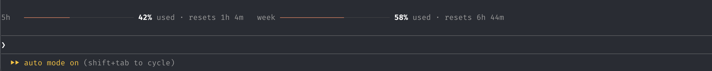

# usage-meter

A slim band above the prompt showing how much of your 5-hour and weekly Claude Code limits you have used, and when each one resets.



## Install

```
/plugin marketplace add verdantran/my-claude-mods
/plugin install usage-meter@my-claude-mods
```

## How it behaves

- **Colour:** bars use your session colour from `/color`, falling back to the theme's accent. Each session remembers its colour.
- **Warnings:** a bar turns to the warning colour at 75% and the error colour at 90%.
- **Narrow terminals:** the bars stack vertically when there isn't room for them side by side.
- **Resets:** once a reset time passes, that bar drops to 0% without waiting for fresh data.
- **When it's hidden:** the band only appears once Claude Code has reported your rate limits, so plans without usage limits won't see it. It also steps aside while a feedback survey is showing.

The last known limits are saved between sessions, so the band shows up straight away when you start Claude Code.
